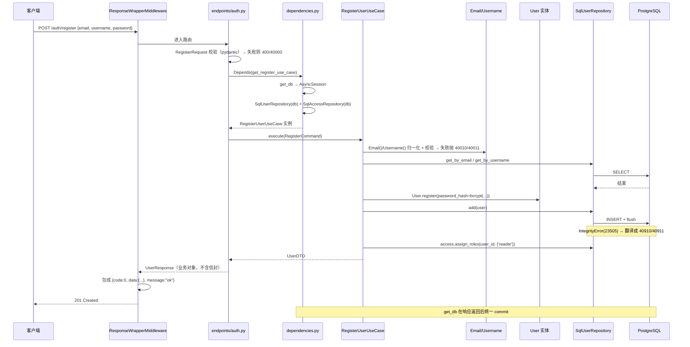
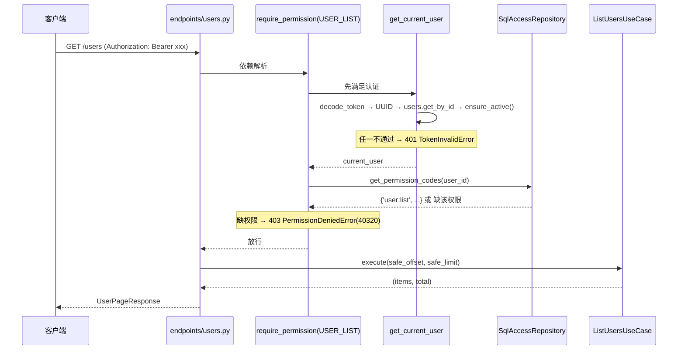

# AgentWeb 后端架构导读：每一层在干什么，以及它们如何拼起来

> 本文配套 [backend.md](./backend.md)（分层范式手册）与 [PLAN.md](./PLAN.md)（任务表）使用。
> `backend.md` 讲的是「通用范式怎么归位」，本文讲的是「**这个仓库里实际写下的代码**每个文件是什么、谁调用谁、一次请求怎么走完」。
> 案例以 `identity`（身份与认证）上下文为主线，`access`（权限 RBAC）作为跨上下文协作的补充；
> `blog`（文章）与 `interaction`（评论 / 点赞）的落地要点和它们踩过的坑集中在 **§7.5**。

---

## 0. 这份文档怎么用

| 你的问题 | 看哪一节 |
| --- | --- |
| 「四层到底各自管什么？」 | [第 1 节](#1-一张图看懂四层--core) · [第 2 节](#2-每一层到底解决什么问题) |
| 「`application/identity/use_cases.py` 是什么？」 | [4.2](#42-application-应用层用例编排) |
| 「`core/seed.py` 是干嘛的？」 | [6.1](#61-seedpy--把代码里的权限声明搬进数据库) |
| 「`infrastructure` 里 `models` / `mappers` / `repositories` 有啥区别？」 | [4.3](#43-infrastructure-基础设施层技术落地) |
| 「这几层是怎么连起来跑起来的？」 | [第 5 节](#5-各部分是怎么组合生效的完整时序) |
| 「评论树 / 点赞是怎么做的？」 | [7.5](#75-blog-与-interaction最新的两个上下文) |
| 「我要加一个新功能，该往哪写？」 | [第 9 节](#9-新增一个限界上下文要写哪些文件以-blog-为例) |

---

## 1. 一张图看懂四层 + core

```
                                  ┌─────────────────────────┐
   用户 / 前端  ──HTTP───────────▶ │  presentation  表现层    │  收参数、转调用例、转响应
                                  └───────────┬─────────────┘
                                              │ 依赖
                                  ┌───────────▼─────────────┐
                                  │  application  应用层     │  编排「取→算→存」，划事务
                                  └───────────┬─────────────┘
                                              │ 依赖（面向接口）
                                  ┌───────────▼─────────────┐
                                  │  domain  领域层          │  业务规则 / 不变量（纯 Python）
                                  └───────────▲─────────────┘
                                              │ 实现（依赖倒置）
                                  ┌───────────┴─────────────┐
                                  │  infrastructure  基础设施 │  ORM 模型、仓储实现、外部适配
                                  └─────────────────────────┘

        ┌──────────────────────────────────────────────────────────────┐
        │  core 内核（横切）：config / database / exceptions / logging  │
        │  / middleware / seed —— 与业务分层正交，被各层共享            │
        └──────────────────────────────────────────────────────────────┘
```

**依赖方向只有一条规则：由外向内。**

- `domain` 谁都不依赖（不 import FastAPI / SQLAlchemy / Pydantic）。
- `application` 依赖 `domain`，但**只依赖 domain 里的仓储接口**（抽象）。
- `infrastructure` 依赖 `domain` 并**实现**它的接口 —— 这就是依赖倒置：`domain` 不认识 SQL，SQL 来适配 `domain`。
- `presentation` 依赖 `application`，把 HTTP 翻译成用例调用。
- `core` 被各层拿来用，但它自己不含业务。

这条方向线一旦被打破（比如 `domain` 里 `import sqlalchemy`），最直接的后果就是：**领域规则没法脱离数据库被单测**。

---

## 2. 每一层到底解决什么问题

### 2.1 `domain` —— 业务是什么

> 一句话：**把不可违背的业务规则固化下来，且不认识任何框架。**

放什么：

| 文件 | 内容 | 例子（identity） |
| --- | --- | --- |
| `entities.py` | 实体 / 聚合根，带行为方法 | `User.register()`、`User.change_password()`、`User.ensure_active()` |
| `value_objects.py` | 值对象，**构造即校验** | `Email`、`Username` |
| `repositories.py` | 仓储**接口**（端口），只声明能力 | `UserRepository.get_by_email()` |
| `exceptions.py` | 领域异常，纯 Python | `EmailAlreadyRegisteredError` |

关键点：

- **实体不是数据袋子**。`User.change_password()` 会校验入参必须是哈希（`_assert_hashed`），这条规则无论从哪个入口来都生效。
- **值对象是「非法值进不来」的闸门**。`Email("  ALICE@Example.COM ")` 会在 `__post_init__` 里归一化成 `alice@example.com`，于是全项目只有一个归一口径。`frozen=True` 保证它不可变。
- **唯一性不由领域独占**。`RegisterUserUseCase` 的「先查重」只为友好报错，真正的唯一性由数据库唯一索引兜底（并发下先查重会漏判）。

### 2.2 `application` —— 业务怎么做

> 一句话：**编排「取数据 → 调领域规则 → 存数据」，本身不含业务规则。**

放什么：每个上下文两个文件。

| 文件 | 内容 |
| --- | --- |
| `use_cases.py` | 用例类，一个类 = 一个业务动作 |
| `dto.py` | 应用层的数据载体：`*Command`（写入参）、`*Query`（读入参）、`*DTO`（出参） |

`use_cases.py` **是干什么的**（这是你问的核心问题之一）：

一个「用例」就是一次完整的业务操作。以 `identity` 为例：

| 用例类 | 对应业务动作 | 编排步骤 |
| --- | --- | --- |
| `RegisterUserUseCase` | 注册 | 升格值对象 → 查重 → 哈希密码 → 建实体 → 落库 → 授予初始角色 |
| `LoginUserUseCase` | 登录 | 按邮箱取用户 → 验密 → 查禁用 → 签发 JWT |
| `GetCurrentUserUseCase` | 读当前用户 | 按 id 取用户，取不到抛 404 |
| `UpdateProfileUseCase` | 改资料 | 过滤「没传的字段」→ 调实体 → 存 |
| `ChangePasswordUseCase` | 改自己密码 | 验旧密码 → 换新哈希 → 存 |
| `ResetUserPasswordUseCase` | 管理员重置他人密码 | 直接换新哈希（**不验旧密码**） |

用例**做**：编排、把技术异常翻译成领域语义、事务内的多次仓储调用。
用例**不做**：业务规则（在 `domain`）、参数格式校验（在 `presentation` 的 schema）、`commit`（在 `core/database.py`）。

关于 DTO，两个设计细节值得记住：

- **`RegisterCommand` 里的 `password` 是明文** —— 它只允许在用例里停留到 `_hash_password()` 完成那一刻。
- **`Unset` 哨兵**：`UpdateProfileCommand` 用 `UNSET` 区分「没传」（不改）与「传了 null」（清空）。这是 PATCH 语义的落点，也是为什么路由里用 `exclude_unset=True` 而不是 `exclude_none=True`。

### 2.3 `infrastructure` —— 业务靠什么实现

> 一句话：**把领域概念翻译成具体技术（这里是 PostgreSQL + SQLAlchemy）。**

三个子目录各司其职，这是最容易混淆的地方：

| 子目录 | 回答的问题 | 例子 |
| --- | --- | --- |
| `models/` | **表长什么样**（列、类型、索引、约束） | `UserModel` → `users` 表，`email` 带 `unique=True` |
| `mappers/` | **实体 ↔ 模型怎么互转** | `to_model()` / `to_entity()` / `apply_to_model()` |
| `repositories/` | **怎么用 SQL 实现仓储接口** | `SqlUserRepository` 实现 `UserRepository` |
| `base.py` | ORM 公共底座（`Base` / `IDMixin` / `TimestampMixin`） | 统一 `UuidPk`、`created_at` 的取值口径 |

三者是**三件事**，不要合并：

- **模型 ≠ 实体**。`UserModel` 只管表结构；业务规则在 `User`。直接改模型绕开实体 = 丢掉不变量。
- **映射器必须显式**。`to_entity()` 逐个字段搬运而不用 `**kwargs`，这样「模型加了字段但忘了翻译」在 code review 里一眼能看出来。
- **仓储不 `commit`**。它只 `flush()`，事务边界归 `core/database.py` 独占。

一个跨层细节：`SqlUserRepository` 会把 PostgreSQL 的 `23505`（唯一约束冲突）**翻译成领域异常** `EmailAlreadyRegisteredError`。不翻译的话，`application` 就得 `import sqlalchemy` 才能判断错在哪 —— 分层立刻破功。

### 2.4 `presentation` —— 业务怎么对外暴露

> 一句话：**收参数、转调用例、转响应。一个 `if` 的业务判断都不该有。**

| 文件 | 内容 |
| --- | --- |
| `dependencies.py` | 依赖注入装配点 + 认证/授权守卫 |
| `api/v1/router.py` | 聚合各 endpoint 的路由 |
| `api/v1/endpoints/*.py` | 具体接口（一个文件一组资源） |
| `api/v1/schemas/*.py` | 请求/响应模型（**唯一**做参数格式校验的地方） |

这里的两个「唯一」很关键：

- **schema 是唯一做格式校验的地方**。`RegisterRequest` 校验邮箱格式、用户名正则、密码长度。校验通过后进入 `application` 的就是干净数据，所以 DTO 用标准库 `dataclass` 而不用 Pydantic。
- **响应模型刻意不复用实体**。`UserResponse` 里**根本没有** `password_hash` 字段 —— 「不小心把密码哈希返回前端」这种事故在类型层面就不可能发生（对应 PLAN.md 第八章 DoD）。

### 2.5 `core` —— 横切内核

> 一句话：**与业务无关、但所有业务都要用的能力。**

| 文件 | 职责 |
| --- | --- |
| `config.py` | 配置中心，`get_settings()` 单例，分组 `AppSettings / DatabaseSettings / SecuritySettings / CorsSettings` |
| `database.py` | 引擎 + 会话工厂 + `get_db`（**唯一事务边界**） |
| `exceptions.py` | 异常基类 re-export、通用业务异常、统一响应信封、全局异常处理器 |
| `logging.py` | loguru 结构化日志，带 `request_id`（ContextVar） |
| `middleware/` | 洋葱层：计时 / 日志 / CORS / 响应包装 |
| `seed.py` | 启动时幂等同步角色与权限（见 [6.1](#61-seedpy--把代码里的权限声明搬进数据库)） |

---

## 3. 目录地图（带注释的树）

下面是 `apps/backend/src/app/` 的真实结构，每个文件后面标注它属于哪一层、干什么。

```
apps/backend/src/app/
├── main.py                              # 装配总入口：lifespan + 中间件 + 异常 + 路由
│
├── core/                                # ── 横切内核 ──
│   ├── config.py                        #   pydantic-settings 分组配置
│   ├── database.py                      #   engine / AsyncSessionLocal / get_db（唯一事务边界）
│   ├── exceptions.py                    #   通用异常 + 信封 + 全局处理器
│   ├── logging.py                       #   loguru 配置 + request_id
│   ├── seed.py                          #   启动种子：幂等同步角色/权限
│   └── middleware/
│       ├── __init__.py                  #   MIDDLEWARES 列表（顺序=洋葱层）
│       ├── process_time.py              #   全链路计时
│       ├── logging.py                   #   写 request_id
│       └── response.py                  #   包统一信封 {code,data,message}（连 204 也包）
│
├── domain/                              # ── 领域层（纯 Python，不 import 任何框架）──
│   ├── exceptions.py                    #   DomainError 基类（code/message/data/http_status）
│   ├── identity/
│   │   ├── entities.py                  #   User 聚合根 + 业务方法
│   │   ├── value_objects.py             #   Email / Username（构造即校验）
│   │   ├── repositories.py              #   UserRepository 接口（含 get_by_ids 批量查询）
│   │   └── exceptions.py                #   40010~40911 系列领域异常
│   ├── access/
│   │   ├── entities.py                  #   Role/Permission 实体 + 权限点常量 + 角色矩阵声明
│   │   ├── repositories.py              #   AccessRepository 接口
│   │   └── exceptions.py                #   40320 / 40420 / 40920
│   ├── blog/
│   │   ├── entities.py                  #   Post 聚合根 + PostStatus 状态机 + ensure_owned_by
│   │   ├── value_objects.py             #   PostTitle / PostContent / Slug / TagName / Summary
│   │   ├── repositories.py              #   PostRepository 接口
│   │   └── exceptions.py                #   40030~40430（本文件 docstring 里有全局错误码分配表）
│   ├── tag/
│   │   ├── entities.py                  #   Tag 聚合根 + TagStatus/TagType + ensure_manageable_by
│   │   ├── value_objects.py             #   TagDescription + 从 blog 复出的 TagName（单向共享内核）
│   │   ├── repositories.py              #   TagRepository 接口（7 个方法）
│   │   └── exceptions.py                #   40050 / 40051 / 40350 / 40450 / 40950
│   └── interaction/
│       ├── entities.py                  #   Comment 聚合根（任意深度；无 Like 实体，见 §7.5.2）
│       ├── value_objects.py             #   CommentContent / LikeTargetType
│       ├── repositories.py              #   CommentRepository + LikeRepository 接口
│       └── exceptions.py                #   40040~40940
│
├── application/                         # ── 应用层（编排）──
│   ├── identity/
│   │   ├── use_cases.py                 #   注册/登录/读我/改资料/改密/重置密码
│   │   └── dto.py                       #   *Command / *DTO + Unset 哨兵
│   ├── access/
│       ├── use_cases.py                 #   读我的权限/列角色/列权限/列用户/分配角色
│       └── dto.py                       #   AssignRolesCommand / RoleDTO / ...
│   ├── blog/
│   │   ├── use_cases.py                 #   建/改/发/下架/删/读/列表（含「我的文章」）
│   │   └── dto.py                       #   *Command / PostDTO / PostSummaryDTO
│   ├── tag/
│   │   ├── use_cases.py                 #   列表/建/改/改状态/软删（post_count 由仓库 JOIN 算出）
│   │   └── dto.py                       #   *Command / *Query / TagDTO / TagPageDTO
│   └── interaction/
│       ├── use_cases.py                 #   评论树组装（递归）/发表/撤回/点赞/互动统计
│       └── dto.py                       #   *Command / CommentNodeDTO / InteractionStatsDTO
│
├── infrastructure/                      # ── 基础设施层 ──
│   ├── adapters/                        #   外部服务适配（LLM 等，待实现 → M6）
│   └── persistence/
│       ├── base.py                      #   Base / IDMixin / TimestampMixin / SoftDeleteMixin
│       ├── models/                      #   共 10 个模型
│       │   ├── __init__.py              #   ★ 模型登记处（漏登记 → 迁移静默漏表）
│       │   ├── user.py / role.py / permission.py
│       │   ├── user_role.py / role_permission.py    # 联合主键，故意继承裸 Base
│       │   ├── post.py / post_tag.py                 # blog
│       │   ├── tag.py                                # tag
│       │   └── comment.py / like.py                  # interaction
│       ├── mappers/
│       │   ├── user.py / access.py / post.py         # to_model / apply_to_model / to_entity
│       │   ├── tag.py                                #   ★ 不从 mappers/__init__.py re-export（会盖掉 post）
│       │   └── comment.py                            #   ★ content 两端都必须用裸 str，不能包 VO
│       └── repositories/
│           ├── user.py / access.py / post.py
│           ├── tag.py                   #   SqlTagRepository（post_count 的 JOIN+GROUP BY 在这）
│           └── interaction.py           #   SqlCommentRepository + SqlLikeRepository（递归 CTE 在这）
│
└── presentation/                        # ── 表现层 ──
    ├── dependencies.py                  #   ★ 依赖注入 + get_current_user + require_permission
    └── api/v1/
        ├── router.py                    #   /api/v1 总路由
        ├── endpoints/
        │   ├── health.py                #   GET /health
        │   ├── auth.py                  #   /auth/register|login|me|me/access|me|change-password
        │   ├── users.py                 #   /users（管理接口，挂 require_permission）
        │   ├── roles.py                 #   /roles
        │   ├── posts.py                 #   公开读 + 授权写；另有 me_router（/me/posts）
        │   ├── comments.py              #   /posts/{id}/comments + /comments/{id}（DELETE 204）
        │   ├── likes.py                 #   /likes/toggle + /posts/{id}/interactions
        │   └── tag.py                   #   /tags（公开读 + tag:manage 写 + 作者改自己的）
        └── schemas/
            ├── auth.py / access.py      #   RegisterRequest / UserResponse / RoleResponse ...
            ├── post.py                  #   CreatePostRequest / PostResponse / PostPageResponse
            ├── tag.py                   #   CreateTagRequest / UpdateTagRequest / TagResponse
            └── comment.py / like.py     #   ★ CommentResponse.from_dto 必须逐字段对齐 DTO
```

---

## 4. 案例：`identity` 上下文，一个文件一个文件讲

选 `identity` 的理由：它是**最短**的一条从 HTTP 一直打到数据库再回到 HTTP 的完整闭环，
六层（含 core）全都在场，而且没有业务分支干扰——先把这条线看透，再看 `blog` / `interaction`
（见 §7.5）里的状态机、软删除、递归查询时就只剩下「多出来的东西」了。

### 4.1 领域层（`domain/identity/`）

#### `value_objects.py` —— 非法值进不来的闸门

```python
@dataclass(frozen=True, slots=True)
class Email:
    value: str

    def __post_init__(self) -> None:
        normalized = self.value.strip().lower()   # 归一化
        if len(normalized) > EMAIL_MAX_LEN: ...
        if not _EMAIL_RE.match(normalized): raise InvalidEmailError()
        object.__setattr__(self, "value", normalized)   # frozen 下唯一改值方式
```

**为什么重要**：注册时 `Email("Alice@Example.COM")` 变成 `alice@example.com`，之后查重、落库、登录查库全用同一个口径。若没有这层，就会出「注册能过、登录失败」这种只在特定输入下出现的怪 bug。

`EMAIL_MAX_LEN` 这个常量同时被 `UserModel` 的列宽引用 —— **领域规则是唯一来源**，避免「值对象放行、数据库截断」。

#### `entities.py` —— 有行为的实体，不是数据袋子

`User` 是聚合根，带四个业务方法：

| 方法 | 固化的不变量 |
| --- | --- |
| `User.register(...)` | 新用户的**唯一构造入口**；标识由领域生成（`uuid4()`）；校验 `password_hash` 确实像哈希 |
| `change_password(hash)` | 入参必须是哈希（`_assert_hashed` 兜底），防止明文误写 |
| `update_profile(...)` | PATCH 语义：`_UNSET` 跳过、`None`/空串清空 |
| `ensure_active()` | 账号停用则抛 `InactiveUserError`（登录与后续鉴权共用这道守卫） |

`_blank_to_none()` 把空串统一按「清空」处理 —— 让调用方不必写「`if bio` 和 `if bio is None` 两套判空」。

#### `repositories.py` —— 端口，不是实现

```python
class UserRepository(ABC):
    @abstractmethod
    async def get_by_email(self, email: Email) -> User | None: ...
```

注意签名里用的是 **`Email` 值对象**，不是 `str`。这个细节把「归一化」的责任牢牢钉在值对象上：仓储实现里直接取 `email.value`，不重复实现一遍小写化。

#### `exceptions.py` —— 错误码的落点

错误码规范：`HTTP 状态码 × 100 + 同类序号`。

| 异常 | code | HTTP | 何时抛 |
| --- | --- | --- | --- |
| `InvalidEmailError` | 40010 | 400 | 值对象构造失败（带 `data.field="email"`） |
| `InvalidUsernameError` | 40011 | 400 | 同上 |
| `WeakPasswordError` | 40012 | 400 | 密码明文/超 72 字节 |
| `InvalidCredentialsError` | 40110 | 401 | 邮箱不存在**或**密码错误（统一文案，防枚举） |
| `TokenInvalidError` | 40111 | 401 | token 缺失/过期/用户已删 |
| `InactiveUserError` | 40310 | 403 | 账号停用 |
| `UserNotFoundError` | 40410 | 404 | 用户不存在 |
| `EmailAlreadyRegisteredError` | 40910 | 409 | 唯一索引冲突翻译而来 |
| `UsernameAlreadyTakenError` | 40911 | 409 | 同上 |

注意 `TokenInvalidError` 覆盖了「过期」和「签名不符」两种情况且**不区分提示** —— 免得告诉攻击者「你这个 token 只是过期了」。

### 4.2 `application` 应用层（用例编排）

#### `dto.py` —— 应用层说的话

三类载体 + 一个哨兵：

| 名称 | 方向 | 说明 |
| --- | --- | --- |
| `RegisterCommand` / `LoginCommand` / `ChangePasswordCommand` / `ResetPasswordCommand` / `UpdateProfileCommand` | 入（写） | 只有「已经合法的数据」 |
| `UserDTO` / `TokenDTO` / `AuthResultDTO` | 出 | 不含 `password_hash` |
| `Unset` / `UNSET` | 哨兵 | 区分「没传」与「传 null」 |

`ResetPasswordCommand` 与 `ChangePasswordCommand` 的**区别体现在类型上**：前者没有 `old_password` 字段。若用 `old_password: str | None` 加运行期分支兼容，那么「忘记传旧密码」会被静默当成管理员重置 —— 普通用户就能绕过二次确认。

#### `use_cases.py` —— 编排的心脏

以最长的 `RegisterUserUseCase` 为例，五步编排：

```python
async def execute(self, command: RegisterCommand) -> UserDTO:
    email = Email(command.email)                    # ① 升格值对象（归一化只做一次）
    username = Username(command.username)

    if await self._users.get_by_email(email):        # ② 查重（友好报错）
        raise EmailAlreadyRegisteredError()
    if await self._users.get_by_username(username):
        raise UsernameAlreadyTakenError()

    user = User.register(                            # ③ 哈希 + 建实体（明文就此丢弃）
        email=email, username=username,
        password_hash=_hash_password(command.password, rounds=self._bcrypt_rounds),
    )
    created = await self._users.add(user)            # ④ 落库（flush，唯一冲突在这里抛）
    await self._access.assign_roles(                 # ⑤ 授予初始角色（同一事务！）
        _require_id(created), {self._role_for(email)}
    )
    return UserDTO.from_entity(created)
```

几个值得注意的设计：

- **用例依赖两个上下文的抽象**：`UserRepository` + `AccessRepository`。跨上下文协作，但依赖的仍是接口（依赖倒置没破）。
- **第 ④⑤ 步在同一事务里**：角色分配失败会把用户一起回滚，**绝不会留下「有账号但一条权限都没有」的半成品**。
- **`_role_for()` 单独抽成方法**：它是「策略」（引导邮箱 → admin，其余 → reader），以后可能改成邀请码机制，届时只改一处。
- **`TokenConfig` 显式注入**，而不是用例内部读 `get_settings()`：测试不必改环境变量，且「这个用例需要什么」一目了然。

`LoginUserUseCase` 里有一处安全顺序很讲究 —— **先验密码，再查禁用状态**：

```python
if user is None or not verify_password(command.password, user.password_hash):
    raise InvalidCredentialsError()   # 用户不存在与密码错误共用同一文案
user.ensure_active()                  # 若这行在前，等于承认「这个账号存在且密码正确」
```

### 4.3 `infrastructure` 基础设施层（技术落地）

#### `persistence/base.py` —— ORM 底座

- `Base`：Declarative 基类，带命名约定（`NAMING_CONVENTION`），Alembic 的 `target_metadata` 指向它。
- `IDMixin`：`id: Mapped[UuidPk]`，UUID 主键。用 `insert_default` 而不是 `default` —— 因为 `MappedAsDataclass` 下 `default` 会**同时成为构造器默认值**，而 id 必须由领域显式传入（`User.register()` 里 `uuid4()`）。这就是为什么「每个模型构造都要显式传 `id`」。
- `TimestampMixin`：`created_at` / `updated_at` 用 `init=False` 排除出构造器（审计字段，业务不该传），且规避 dataclass 的字段顺序冲突。

#### `persistence/models/user.py` —— 表结构

`UserModel` 是 `users` 表：`email`/`username` 带 `unique=True, index=True`（这是唯一性的最终防线），列宽复用领域常量。还手写了 `__repr__` —— 因为 `MappedAsDataclass` 默认会把**所有**字段打进 repr，而 fastapi/uvicorn 的异常日志会打印对象，密码哈希会因此进日志。

#### `persistence/mappers/user.py` —— 翻译官

| 函数 | 用途 |
| --- | --- |
| `to_model(entity)` | 实体 → 模型（**仅新建**）。不传 `created_at`，交给 `insert_default` |
| `apply_to_model(entity, model)` | 把可变字段刷到**已存在**的模型（更新）。不碰 id/时间戳 |
| `to_entity(model)` | 模型 → 实体，逐字段显式搬运 |

#### `persistence/repositories/user.py` —— 仓储实现

`SqlUserRepository` 做两件事：**翻译领域语义 ↔ SQL**，以及**把技术异常翻译成领域异常**。

```python
except IntegrityError as exc:
    _raise_translated(exc)   # PG 23505 + constraint 名 → EmailAlreadyRegisteredError
```

它**不 commit**（交给 `get_db`）、**不吞异常**（翻译完立刻抛）。另外 `list_paged` 的排序键带上 `id`：同一批插入的行 `created_at` 可能相同，只按时间排序会让翻页出现重复/漏行。

### 4.4 `presentation` 表现层

#### `api/v1/schemas/auth.py` —— HTTP 边界

请求模型（`RegisterRequest` 等）在这里做**唯一一次格式校验**；响应模型（`UserResponse` 等）用 `from_attributes=True` 直接从应用层 DTO 构造，无需手写搬运。

用户名规则在 schema 和值对象里各写了一遍 —— **这是刻意的**：schema 负责「尽早给出友好提示」，值对象负责「无论从哪个入口进来都合法」，后者才是安全边界。

#### `api/v1/endpoints/auth.py` —— 薄薄一层

表现层只做三件事：**收参数 → 转调用例 → DTO 转响应**。

```python
@router.post("/register", response_model=UserResponse, status_code=201)
async def register(payload: RegisterRequest, use_case: ...) -> UserResponse:
    user = await use_case.execute(RegisterCommand(
        email=payload.email, username=payload.username,
        password=payload.password, display_name=payload.display_name,
    ))
    return UserResponse.model_validate(user)
```

handler **不返回** `{code,data,message}` —— 信封由 `ResponseWrapperMiddleware` 统一加。

`update_me` 里有一行是 PATCH 语义的关键：

```python
command = UpdateProfileCommand(**payload.model_dump(exclude_unset=True))
```

`exclude_unset=True` 让「没传的字段」保持 `UNSET`；换成 `exclude_none=True`，客户端就无法表达「把签名清空」。

#### `dependencies.py` —— 装配点（本项目的枢纽）

这个文件不属于 `api/v1/`，而是单独放在 `presentation/` 下，因为它管的是**全局装配**。它干三件事：

**① 把接口和实现接上**

```python
async def get_user_repository(db: Annotated[AsyncSession, Depends(get_db)]) -> UserRepository:
    return SqlUserRepository(db)
```

返回类型标注成**接口** `UserRepository` 而不是 `SqlUserRepository` —— 类型注解即契约，想换实现只改这一行。

**② 组装用例（构造函数注入）**

```python
async def get_register_use_case(users, access) -> RegisterUserUseCase:
    return RegisterUserUseCase(users, access,
        bcrypt_rounds=get_settings().security.bcrypt_rounds,
        bootstrap_admin_email=get_settings().app.bootstrap_admin_email)
```

**③ 认证与授权守卫**

| 守卫 | 作用 | 失败 |
| --- | --- | --- |
| `get_current_user` | 解 Bearer token → 查用户 → 查禁用 | 401 `TokenInvalidError` |
| `require_permission(code)` | 工厂函数，生成「要求某权限」的依赖 | 403 `PermissionDeniedError`(40320) |

`require_permission` 每次请求**现查一次权限**（不塞进 token）：token 里带权限能省一次查询，但撤权要等 token 过期才生效 ——「刚把某人降级、他还能用十分钟」对管理接口不可接受。

---

## 5. 各部分是怎么组合生效的（完整时序）

### 5.1 写路径：`POST /api/v1/auth/register`



要点：**事务边界在 `get_db`**。第 ④⑤ 步（建用户 + 分配角色）用的是同一个 session，任何一步抛异常 → `get_db` 里 `rollback()` → 全部回滚。

### 5.2 鉴权路径：`GET /api/v1/users`（管理接口）



**认证（401）与授权（403）是两个异常、两个处理器、两个状态码。** `get_current_user` 管「你是谁」，`require_permission` 管「你能不能」。默认拒绝：漏挂守卫的接口会 401 而不是放行。

前端拿 `/auth/me/access` 的 `permission_codes` 决定「显不显示按钮」，判断依据是**权限码**而非角色名 —— 与后端守卫校验的是同一件东西。

---

## 6. `core` 里的横切能力逐个讲

### 6.1 `seed.py` —— 把代码里的权限声明搬进数据库

```python
async def seed_access_catalog() -> dict[str, int]:
    async with AsyncSessionLocal() as session:          # ① 独立会话
        repo = SqlAccessRepository(session)
        result = await repo.sync_catalog(ROLE_SPECS, PERMISSION_SPECS)
        await session.commit()                          # ② 自己提交
    logger.info("🌱 权限种子数据已对齐: {result}", result=result)
    return result
```

三个问题一次说清：

**① 它是干什么的**：把 `domain/access/entities.py` 里声明的**角色 / 权限矩阵**幂等同步进库。事实来源是**代码声明**，不是数据库现状。

**② 幂等怎么做到**：`SqlAccessRepository.sync_catalog()` 分三步 —— `_sync_permissions`（补建缺失 + 刷新展示信息）、`_sync_roles`、`_sync_role_permissions`（对齐绑定，**不做删除**）。重复运行不产生新行；「不做减法」是为了避免抹掉运维手工建的角色及其用户绑定。

**③ 为什么自己开会话并提交**：lifespan 阶段没有请求上下文，用不了 `get_db` 那个「请求级事务」。所以它是全项目**唯一**允许自己 `commit()` 的地方。

**什么时候跑**：`main.py::lifespan` 在 `yield` 之前 `await seed_access_catalog()`。

> ⚠️ 测试环境注意：`ASGITransport` 不跑 lifespan，所以集成测试用 `tests/integration/conftest.py::seeded_access_catalog`（autouse）手动补齐，否则注册会因 `RoleNotFoundError` 报 404。

### 6.2 `database.py` —— 唯一事务边界

```python
async def get_db() -> AsyncIterator[AsyncSession]:
    async with AsyncSessionLocal() as session:
        try:
            yield session
            await session.commit()      # 正常返回 → 提交
        except Exception:
            await session.rollback()    # 抛异常 → 回滚
            raise                        # ⚠️ 必须重新抛，不能吞
        finally:
            await session.close()
```

**任何仓储 / 用例都不允许自行 commit / rollback / close。** `expire_on_commit=False` 保证 commit 后实体仍可读取。

### 6.3 `exceptions.py` —— 异常 → 信封的统一出口

继承链：

```
Exception
└── DomainError                （住在 domain/，纯 Python）
    ├── ApplicationError
    │   ├── ValidationError    40000
    │   ├── AuthenticationError 40101
    │   ├── UnauthorizedError   40100
    │   ├── ForbiddenError      40300
    │   ├── NotFoundError       40400
    │   └── ConflictError       40900
    └── InfrastructureError
        └── InternalServerError 50000
```

`core/exceptions.py` **re-export** `DomainError`（从 `domain/exceptions.py`）—— 既保证 `domain` 能脱离框架被测试，又让既有 `from app.core.exceptions import DomainError` 继续可用。

四个全局处理器（`register_exception_handlers`）：

| 处理器 | 覆盖 | 结果 |
| --- | --- | --- |
| `_domain_handler` | `DomainError` 及其子类 | `{code, message, data}` + 推导出的 HTTP 状态 |
| `_validation_handler` | `RequestValidationError` | **400 + code 40000**（不是 422！） |
| `_http_exception_handler` | `HTTPException` | `status*100` 作业务码 |
| `_unexpected_handler` | `Exception` | 50000；debug 下附 traceback |

所有处理器都会 `_mark_handled(request)` 并加 `X-Error-Handled: 1` 响应头 —— 这是给响应包装中间件的「别重复包装」信号。

### 6.4 `middleware/` —— 洋葱层

`MIDDLEWARES` 列表的顺序 = 由外到内的层序：

```python
MIDDLEWARES = [
    Middleware(ProcessTimeMiddleware),        # 1 最外层：全链路计时
    Middleware(LoggingMiddleware),            # 2 次外层：写 request_id
    Middleware(CORSMiddleware, ...),          # 3 中间：处理预检，避免被改写
    Middleware(ResponseWrapperMiddleware),    # 4 最内层：包统一信封
]
```

`ResponseWrapperMiddleware` 有 6 个**跳过包装**的条件，最值得注意的是：OpenAPI 文档路径必须原样返回（否则 Swagger UI 报 `does not specify a valid version field`）、`request.state.is_stream`（SSE/WS）、以及异常处理器已构造好信封的标记。

### 6.5 `config.py` —— 配置中心

`pydantic-settings` 分组建类，`get_settings()` 是带 `lru_cache` 的单例。两个细节：

- `bootstrap_admin_email` 用 `EmailStr` 而不是 `str`：写错一个字母会**静默不生效**，宁可在启动时直接报错。
- `_blank_email_means_disabled` 校验器把空串转成 `None`：运维在 `.env` 里留一行 `APP__BOOTSTRAP_ADMIN_EMAIL=` 表示关闭，比删整行常见，不特判会让启动报错方向跑偏。

---

## 7. `access` 上下文：跨上下文协作与 RBAC

`access` 是第二个上下文，用来展示「多上下文如何共处」。

**协作关系**：

```
identity ──依赖──▶ access       （注册时要 assign_roles）
access   ──依赖──▶ identity     （分配角色前要确认用户存在）
```

双向依赖为什么没成环：因为两者依赖的都是**对方的仓储抽象**，且 `access` 的用例通过 `UserRepository` 只做「存在性检查」，`identity` 通过 `AccessRepository` 只做「分配角色」。真正的循环（表关联层面的）由 `/auth/me/access` 独立端点规避 —— 把角色塞进 `UserResponse` 会让 `identity` 被迫依赖 access 的角色表。

**RBAC 数据**来自 `domain/access/entities.py` 的**声明区**：

| 角色 | 权限 |
| --- | --- |
| `admin` | `_ALL_PERMISSION_CODES`（全部 16 个） |
| `author` | reader 的 4 个 + `post:create/update/publish/delete`（共 8 个） |
| `reader` | `comment:create`、`comment:delete`、`like:toggle`、`agent:chat` |

★ 三个 `*_any` 权限码（`post:update_any` / `post:delete_any` / `comment:delete_any`）**只有 admin 持有**，
`author` 刻意不给——它们不是「更强一点的编辑权」，而是「跨过归属检查的钥匙」，见下文。
`comment:delete` 则是读者的**入场券**而不是特权：没有它，读者发出去的评论永远删不掉。

★ `tag:manage`（管理标签：新建 / 下架 / 删除）同样**只有 admin 持有**，而且它在守卫里是
**唯一一个不需要返回权限快照就能表达边界的写权限**——因为「标签是公共词汇表」这件事
本身就是全局的，见 §7.6。

改这里 = 改种子数据（下次启动生效），`require_permission` 引用的也是同一批 `PermissionCode` 常量。

**守卫挂载方式**（`endpoints/users.py`）：

```python
@router.get("", dependencies=[Depends(require_permission(PermissionCode.USER_LIST))])
```

不需要当前用户时挂在 `dependencies=` 里；需要时直接当参数注解 `current_user: Annotated[User, Depends(require_permission(code))]`。

**布尔权限表达不了「只能改自己的」——所以归属检查放在实体上**（`blog` / `interaction` 都已落地）：
RBAC 只能回答「这个角色有没有 `post:update`」，回答不了「这一条是不是他的」。行级归属（水平权限）
因此做成两段：

1. 守卫 `require_permission(POST_UPDATE)`（40320）—— 回答「你能不能做这类操作」；
2. 实体方法 `Post.ensure_owned_by(actor, has_override=...)`（40330）、
   `Comment.ensure_deletable_by(actor_id, has_override=...)`（40340）—— 回答「这一条是不是你的」。

第二段需要知道「调用者是否持有越权位」，所以守卫有第二个形态
`require_permission_with_codes(code) -> frozenset[str]`：它**返回**当前请求的权限快照，
用例把 `PermissionCode.POST_UPDATE_ANY in codes` 当作 `has_override` 传下去。
复用同一份快照既省一次查询，也避免了「守卫通过之后管理员恰好被撤销权限」的竞态。

---

## 7.5 `blog` 与 `interaction`：最新的两个上下文

`identity` / `access` 讲的是「认证与授权」，`blog` / `interaction` 才是**业务**。
这两节的例子值得单独记，因为踩的坑与前面不一样。

### 7.5.1 `blog`：状态机 + 软删除 + 可见性口径

| 关注点 | 结论 |
| --- | --- |
| 状态机 | `draft → published → archived`；草稿只有作者可见，已发布对所有人可见，归档后只读 |
| 软删除 | `deleted_at`；**删除的文章对所有入口等同不存在**（回 404，不是 403） |
| 可见性 | 「看不见」与「不是你的」是两种回答：**别人的草稿回 404**（存在性也是隐私），**已发布但不是自己的回 403** |
| 路由 | 公开的 `GET /posts`、`GET /posts/{slug}` 用 `OptionalCurrentUser`（匿名可读）；「我的文章」是 `GET /me/posts`，**不复用 `/posts/mine`**——后者会永久遮蔽一篇 slug 恰好是 `mine` 的文章 |
| 标识 | slug 是对外标识（可写进 URL / 可分享），`post_id` 才是内部主键；评论等子资源一律用 id |

### 7.5.2 `interaction`：跨上下文的三种典型手法

**① 依赖而不合并**：评论要判断「文章是否可见 / 是否已关闭」，所以 `interaction` 依赖 `blog`。
但依赖被压到最小——`domain/interaction/*` 只 import `app.domain.blog.entities.PostStatus` 与
`PostNotFoundError`，反向不存在。**仓储、实体、用例一律不互借。**

**② 聚合根不一定有实体**：点赞**没有 `Like` 实体**，也没有对应的领域行为。
点赞没有生命周期、没有状态迁移，唯一的规则是 `unique(user_id, target_type, target_id)`——
那是数据库的活，不是领域的活。所以 `domain/interaction/` 里只有值对象 `LikeTargetType`，
`LikeRepository` 只有 `add / remove / is_liked / count / count_many / liked_ids`。

**③ 跨上下文批量补数据**：评论要显示「用户 A 回复 B」。最自然的写法是每条评论去查一次用户，
但那是**三重错误**：把 N+1 搬进浏览器、`GET /users/{id}` 要 `user:list`（admin 权限，匿名读者根本调不动）、
每个请求还得重新鉴权。正确做法是**在服务端批量补齐**：`UserRepository.get_by_ids(ids)`
一条 `IN (...)` 取回字典，响应里带上 `author_display_name` / `parent_author_display_name`
（`display_name` 优先、回落 `username`）。前端只渲染字段，永不按 id 反查。

> `get_by_ids` 必须在空入参时直接返回 `{}`：`IN ()` 在部分驱动下是**语法错误**，不是「空结果」。

### 7.5.3 评论树：任意深度，但缩进是界面的事

- `comments.parent_id` 存的是**真正被回复的那条评论**，不做任何「归一到根」的折算。唯一的结构不变量
  是**父链无环**，由时间顺序天然保证（父必定先于子存在）。
- 曾经的实现是「两层树」：`COMMENT_TREE_DEPTH = 2`，回复「回复的回复」时用 `Comment.thread_root_id`
  把父节点折算到根。**这个做法是不可逆的**——信息一旦折掉，就再也恢复不出真实父节点，
  于是「谁回复了谁」永久丢失。现已删除。
- 递归查询用**列清单 CTE**（`anchor = select(CommentModel)` + `union_all`）；
  可见根的判定（`_visible_root_cte`）也是递归 CTE，且**每一层都要携带 `node_id`**：
  只带锚点 id 会把「根」解析成叶子，计数会静默错（本项目真实踩过）。
- 取数是**批量**的：`list_descendants(root_ids)` 一次取回全部后代，用例在内存里按 `parent_id` 分组。
- **缩进几层是前端的决定**：前端只有两个视觉层级——第一层回复带一条左边框，第二层**起**全部落在
  同一条竖线上。按 `depth * 16` 算 `paddingLeft` 是这类需求最经典的 bug。

### 7.5.4 两条口径，值得单独记住

- **错误码的口径跟着端点的词汇走，不跟着抛出它的那层走。**
  `POST /likes/toggle` 的目标是多态的（文章或评论），所以「目标不存在」只能有一个答案：40441。用例里
  `try: post.ensure_visible_to(viewer) except PostNotFoundError: raise InteractionTargetNotFoundError from None`
  ——不转的话，同一个「对你不存在的 id」会因为底层行是否物理存在而给出两个错误码，前端得写两条分支。
- **无冗余计数字段。** `comment_count` / `like_count` 一律实时聚合（`count_many` / `count_by_posts`）。
  软删除的评论与点赞是两张表，冗余列要靠跨表事务保证一致（撤回后计数还得跟着减），
  一致性成本远大于一次 `COUNT`。

---

## 7.6 `tag`：行级归属与「共享内核」

标签原本只是 `blog` 里的一张表（随文章提交、自动创建）。当它长出自己的生命周期
（下架、删除、独立管理）之后，它就成了**第五个上下文**。

**① 单向共享内核，而不是双份实现。**
`domain/tag/value_objects.py` 只做一次 re-export：

```python
tag ↦ blog   （TagName / TAG_NAME_MAX_LEN / TAG_SLUG_MAX_LEN）
blog ↦ tag   （不存在）
```

为什么不能各写一份：两份 `TagName` 就是两个长度上限（历史上真的出现过 15/15 与 50/50 并存），
而「同一个名字在两处归化成不同 slug」这种 bug 在集成测试里只表现为随机 409。
依赖方向必须是单向的，且只共享**值对象**，不互相借仓储、实体、用例。

**② 行级归属不能靠权限码，所以守卫分了两级。**
`PUT /tags/{id}` **没有** `require_permission` 守卫，只靠认证；归属由
`Tag.ensure_manageable_by(actor_id, actor_can_manage_any=...)` 判，并把三种情况分开：

| 情况 | 结果 | 理由 |
| --- | --- | --- |
| 系统内置标签（`type=system`）且非管理员 | 40051 | 它**谁都不能改**，不是「别人的」——报 40350 会让人去找不存在的物主 |
| 别人的标签 | 40350 | 是「不是你的」；两个码对应两种完全不同的用户行为 |
| `author_id IS NULL`（作者已注销） | 40350 | 没主人≠人人可改，只剩管理员能动 |
| 自己的 / 持有 `tag:manage` | 通过 | —— |

而 `POST` / `PATCH /status` / `DELETE` 是**全局**操作（改的是一份公共词汇表，删一个标签会让
所有用过它的文章一起变样），所以它们用普通的 `require_permission(TAG_MANAGE)`。
**同一个聚合上两条写路径、两套授权**不是不一致，而是「破坏半径」不同。
唯一的越权位 `actor_can_manage_any` 由 `PermissionCodes`（`frozenset[str]`）算出，
**绝不让客户端用一个字段自称管理员**。

**③ `post_count` 是派生值，不是列。**
标签列表按「被引用次数」排序，这个数字由 `LEFT JOIN post_tags` + `LEFT JOIN posts` +
`GROUP BY tags.id` 算出。**两个统计条件（`status='published'`、`deleted_at IS NULL`）必须写在
JOIN 的 `ON` 里**——挪到 `WHERE` 会把外连接降级成内连接，「只被草稿引用的标签」会从列表里直接**消失**
（而它正是作者回头要找的东西）。同理 `count_tags` 必须另起一条 `select(func.count()).select_from(子查询)`：
直接复用带 `GROUP BY` 的语句来 count，`total` 会数成「标签 × 文章」的行数。

**④ 软删除的语义按聚合自身定义，不强行统一。**
`DELETE /tags/{id}` 是**幂等**的（重复删同样 204），而 `DELETE /comments/{id}` 第二次给 40440。
两者都对：评论的不变量是「已撤回的评论对所有入口等同不存在」，而标签的删除是「收进回收站」，
重复按一下不该报错。把两条线强行统一才是错的。

**⑤ 唯一索引不认 `status`。**
软删除的标签名字与 slug **仍被占用**（删了再建同名 → 40950）。这是数据库的事实、代码里一个字都看不到，
所以只能靠集成测试锁住。推论：`exists_name` / `exists_slug` **故意不过滤 status**，
而改名查重必须 `exclude_id` 排除自己——否则「`x.js` → `x js`」（两者归化成同一个 slug）
会被自己挡下，用户明明只是加了个空格。

---

## 8. 分层铁律与常见越界

| 铁律 | 违反的后果 | 检查位置 |
| --- | --- | --- |
| `domain` 不 import 框架 | 领域规则无法脱离 DB 单测 | `domain/**` 的 import |
| 仓储接口在 `domain`，实现在 `infrastructure` | `application` 被迫 import SQLAlchemy | `application/**` 的 import |
| 事务边界只在 `get_db`，仓储只 `flush` | 事务被切成碎片，回滚不完整 | `repositories/**` 是否出现 `commit` |
| 参数格式校验只在 `presentation` schema | 校验散落成两套口径 | `use_cases.py` 里是否出现正则/长度判断 |
| 业务规则只在 `domain` 实体 | 同一规则两处实现，早晚漂移 | `use_cases.py` 里是否出现 `if` 形式的业务分支 |
| 出参 Schema 不含敏感字段 | 密码哈希泄露 | `schemas/**` 是否出现 `password_hash` |
| 新模型必须在 `models/__init__.py` 登记 | 迁移**静默**漏表 | `models/__init__.py` |

**「谁最外层谁组装」**：`presentation/dependencies.py` 是唯一 `new` 具体仓储的地方。一旦 `application` 自己去 new `SqlUserRepository`，依赖倒置立刻作废。

**用例自己不判断调用者是谁**：`ResetUserPasswordUseCase` 的 docstring 说得很清楚 —— 授权是「这次请求允不允许」的问题（表现层职责），用例只回答「给定一个用户和一份新密码，怎么改」。这样它能被「批量重置」「命令行重置」等任何入口复用。

---

## 9. 新增一个限界上下文要写哪些文件（以 `blog` 为例）

对照 PLAN.md 的 M4，一个完整上下文需要落位这些文件：

| 层 | 文件 | 内容 |
| --- | --- | --- |
| domain | `domain/blog/entities.py` | `Post` 聚合根 + `PostStatus` 状态机 + `ensure_owned_by()` |
| domain | `domain/blog/value_objects.py` | `Slug` 等值对象 |
| domain | `domain/blog/repositories.py` | `PostRepository` 接口 |
| domain | `domain/blog/exceptions.py` | `PostNotFoundError` / `PostForbiddenError`（403xx） |
| domain | `domain/access/entities.py` | 追加 `POST_UPDATE_ANY` 等新权限码（**改声明区**） |
| application | `application/blog/dto.py` | `CreatePostCommand` / `PostDTO` ... |
| application | `application/blog/use_cases.py` | `CreatePostUseCase` / `UpdatePostUseCase` / ... |
| infrastructure | `infrastructure/persistence/models/post.py` | `PostModel`（`author_id` 外键、`deleted_at` 软删） |
| infrastructure | `infrastructure/persistence/models/__init__.py` | **登记新模型**（否则迁移漏表） |
| infrastructure | `infrastructure/persistence/mappers/post.py` | `to_model` / `to_entity` / `apply_to_model` |
| infrastructure | `infrastructure/persistence/repositories/post.py` | `SqlPostRepository`（过滤 `deleted_at IS NULL`） |
| presentation | `presentation/api/v1/schemas/post.py` | `CreatePostRequest` / `PostResponse` |
| presentation | `presentation/api/v1/endpoints/posts.py` | 路由，写操作挂 `require_permission` |
| presentation | `presentation/api/v1/router.py` | `include_router` |
| presentation | `presentation/dependencies.py` | `get_post_repository` + `get_*_use_case` 工厂 |
| 迁移 | `migrations/versions/xxxx_blog.py` | `make revision` 自动生成后校对 |
| 测试 | `tests/unit/test_post.py`、`tests/integration/test_posts_api.py` | 领域规则 + 接口主路径与错误分支 |

对照本仓库现状：`identity`、`access`、`blog`、`interaction` 四个上下文都把四层占满了，
`core` 已全部就位，`presentation/dependencies.py` 里也有可照抄的模板。
**照着 `identity` 抄结构，照着 `access` 抄「跨上下文 + 守卫」，照着 `interaction` 抄「跨上下文读数据 + 递归查询 + 批量补字段」。**

---

## 10. 快速对照表

| 你看到的东西 | 它在哪一层 | 一句话作用 |
| --- | --- | --- |
| `Email` / `Username` | domain | 构造即校验的值对象，唯一归一化口径 |
| `User.register()` / `change_password()` | domain | 实体上固化的业务不变量 |
| `Post.ensure_owned_by()` / `Comment.ensure_deletable_by()` | domain | 行级归属检查（布尔权限表达不了） |
| `Comment.public_content` / `is_deleted` | domain | 墓碑：撤回后内容为空串，但回复关系照常显示 |
| `list_descendants()` / `_visible_root_cte()` | infrastructure | 递归 CTE，支撑任意深度的评论树 |
| `UserRepository.get_by_ids()` | domain（接口）/ infrastructure（实现） | 跨上下文批量补显示名，避免 N+1 |
| `UserRepository`（接口） | domain | 端口，声明「需要什么能力」 |
| `*Command` / `*DTO` | application | 应用层的输入 / 输出载体 |
| `*UseCase.execute()` | application | 编排「取→算→存」，不 commit |
| `UserModel` | infrastructure | `users` 表结构（列/索引/约束） |
| `to_entity` / `to_model` | infrastructure | 实体 ↔ 模型 的显式翻译 |
| `SqlUserRepository` | infrastructure | 用 SQL 实现接口 + 翻译技术异常 |
| `RegisterRequest` / `UserResponse` | presentation | HTTP 边界校验 + 出参裁剪 |
| `require_permission()` | presentation | 生成授权守卫依赖（403） |
| `require_permission_with_codes()` | presentation | 同上，但**返回**权限快照供用例做越权判断 |
| `get_current_user()` | presentation | 解 token + 查禁用（401） |
| `get_db()` | core | 唯一事务边界（commit / rollback） |
| `DomainError` + 全局处理器 | core | 异常 → `{code,message,data}` 信封 |
| `seed.py` | core | 启动时幂等同步角色 / 权限 |
| `ResponseWrapperMiddleware` | core | 统一成功响应信封 |
| `lifespan`（main.py） | core | 装配顺序：日志 → 中间件 → 异常 → 路由 |

---

> 一句话总结：**`domain` 定义「什么是对的」，`application` 编排「怎么做一次」，`infrastructure` 负责「落到哪」，`presentation` 负责「怎么说话」，`core` 提供「所有人都要用的水电煤」。**
> 依赖只能由外向内；事务只在 `get_db`；规则只在 `domain`。
